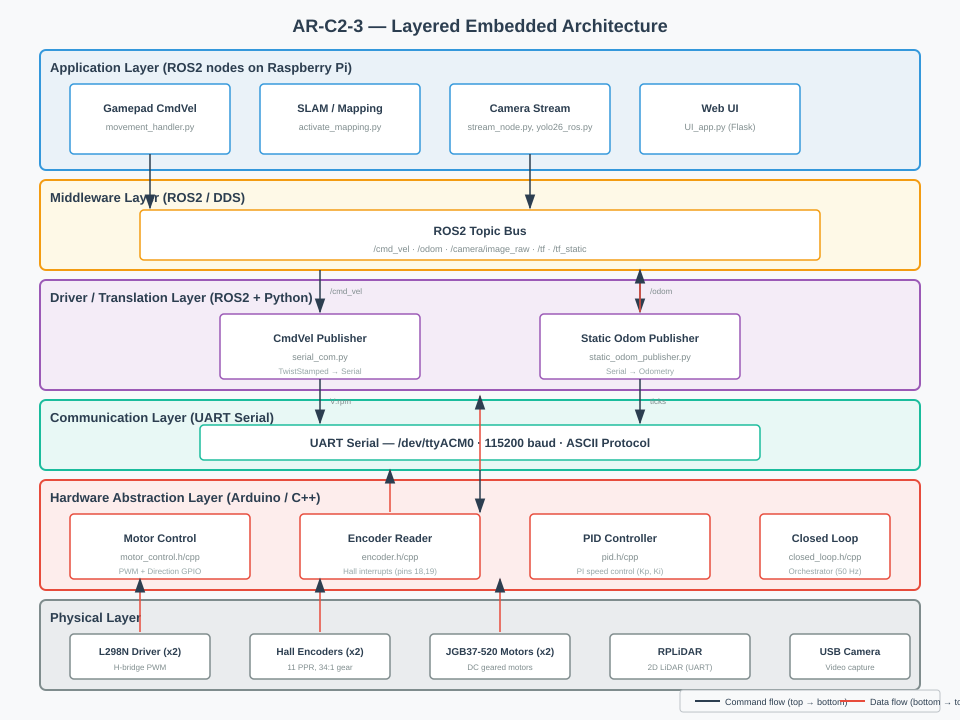
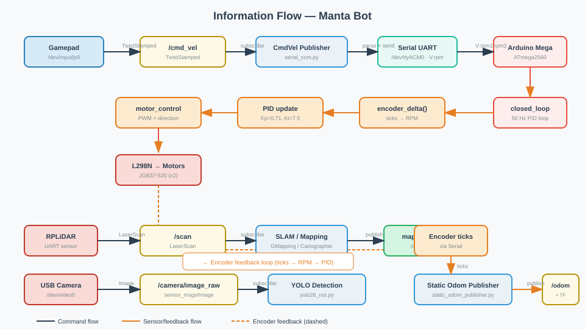
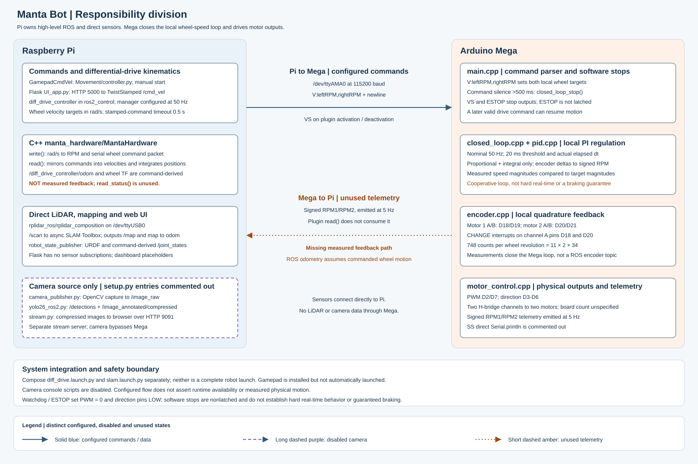

# AR-C2-3 — HAES Level 1: Layered Embedded Architecture

## Project Overview

**Platform:** Mobile robot (Pi + Mega) with differential drive, LiDAR, camera, and gamepad control.  
**Goal:** Present a layered-based software and hardware architecture for the current embedded application.

---

## Task 1 — Architecture

### Proposed Layered Architecture



The architecture consists of six layers, from top to bottom:

1. **Application Layer** — ROS2 nodes on the Raspberry Pi (gamepad teleoperation, SLAM/mapping, camera streaming with YOLO detection, web UI).
2. **Middleware Layer** — ROS2 topic bus (`/cmd_vel`, `/odom`, `/scan`, `/camera/image_raw`, TF tree) providing decoupled publish/subscribe communication.
3. **Driver / Translation Layer** — ROS2 nodes that bridge between the middleware and hardware: `CmdVelPublisher` converts TwistStamped to serial commands, `StaticOdomPublisher` converts encoder data to odometry messages, `FakeLidarNode` translates LiDAR bytes into LaserScan topics.
4. **Communication Layer** — Dedicated UART serial link (`/dev/ttyACM0`, 115200 baud) between the Raspberry Pi and Arduino Mega using an ASCII command protocol.
5. **Hardware Abstraction Layer (Arduino)** — C++ modules on the Mega: `MotorControl` drives L298N H-bridges via PWM + direction GPIO, `EncoderReader` reads hall encoders via interrupts, `PIDController` computes PWM from RPM error, and `ClosedLoop` orchestrates both PID loops at 50 Hz.
6. **Physical Layer** — The actual hardware: L298N motor drivers (x2), JGB37-520 geared DC motors with hall encoders (x2), RPLiDAR, USB camera.

Blue arrows indicate command flow (top → bottom); red arrows indicate data flow (bottom → top).

### Layer Descriptions

#### 1. Application Layer (ROS2 nodes on Raspberry Pi)

| Module | Purpose & Responsibilities | I/O | Communication | Why this layer? | Contribution |
|--------|---------------------------|-----|---------------|-----------------|--------------|
| `GamepadCmdVel` (movement_handler) | Reads joystick events from `/dev/input/js0`, normalises axes, publishes `TwistStamped` on `/cmd_vel`. | In: raw JS event bytes. Out: ROS2 TwistStamped messages. | Publishes to ROS2 topic `/cmd_vel`. | Highest-level user-facing logic; hardware-independent. | Provides teleoperation input for the robot. |
| SLAM / Mapping (`activate_mapping.py`, `static_slam.launch.py`) | Runs GMapping or similar on LiDAR scan data, produces a map and odometry. | In: `/scan` (LiDAR), `/odom`. Out: map, pose estimates. | ROS2 topics + TF frames. | Pure algorithmic layer; no hardware dependency. | Enables autonomous navigation. |
| Camera Stream (`stream_node.py`, `yolo26_ros.py`) | Captures USB camera frames, publishes image topic and runs YOLO object detection. | In: USB camera video stream. Out: `/camera/image_raw`, detection topics. | ROS2 image transport + topics. | Vision processing is application-level; sensor-agnostic via standard ROS2 camera interface. | Provides visual perception for the robot. |
| UI App (`UI_app.py`) | Web-based dashboard showing robot status, camera feed, and control buttons. | In: ROS2 topics (odom, scan, image). Out: HTTP responses to browser. | Flask/HTTP + ROS2 subscriptions. | User interface is decoupled from control logic; can be replaced or extended independently. | Human-machine interaction layer. |

#### 2. Middleware Layer (ROS2)

| Module | Purpose & Responsibilities | I/O | Communication | Why this layer? | Contribution |
|--------|---------------------------|-----|---------------|-----------------|--------------|
| Topic Bus (`/cmd_vel`, `/odom`, `/scan`, etc.) | Decouples publishers from subscribers; provides message routing, QoS, and time synchronisation. | In: all ROS2 topics. Out: same topics to consumers. | DDS (ROS2 middleware). | Standard middleware layer in any ROS2 system; abstracts network transport. | Enables modular, distributed software architecture. |
| TF Tree (`tf_tree.svg`) | Maintains coordinate frame transforms between `base_link`, `odom`, `laser`, etc. | In: odometry + sensor pose data. Out: `/tf` and `/tf_static` topics. | ROS2 TF service. | Coordinate transforms are middleware-level; needed by SLAM, navigation, and visualization. | Provides spatial context for all layers above. |

#### 3. Driver / Translation Layer (ROS2 nodes bridging to hardware)

| Module | Purpose & Responsibilities | I/O | Communication | Why this layer? |
|--------|---------------------------|-----|---------------|-----------------|
| `cmd_vel_publisher` (serial_com.py) | Subscribes to `/cmd_vel`, converts linear/angular velocities into serial commands (`V:<rpm1>,<rpm2>`) sent to the Mega. | In: ROS2 TwistStamped. Out: ASCII strings on Serial. | ROS2 subscription → Serial write. | Translates abstract velocity commands into hardware-specific protocol; sits between middleware and physical comms. |
| `static_odom_publisher` | Reads encoder ticks from the Mega via serial, publishes `/odom`. | In: Serial data (RPM/tick counts). Out: ROS2 Odometry messages. | Serial read → ROS2 publish. | Converts raw sensor data into standard ROS2 format; hardware-specific translation. |
| `FakeLidarNode` (`fakelidarnode.py`) | Translates LiDAR serial stream into `/scan` ROS2 messages. | In: RPLiDar raw bytes. Out: LaserScan messages. | Serial read → ROS2 publish. | Standardises LiDAR data into a ROS2-native format. |

#### 4. Communication Layer (Serial)

| Module | Purpose & Responsibilities | I/O | Communication | Why this layer? |
|--------|---------------------------|-----|---------------|-----------------|
| Serial Link (`/dev/ttyACM0`, 115200 baud) | Bidirectional ASCII protocol between Raspberry Pi and Arduino Mega. | In: tick/RPM data from Mega. Out: velocity commands to Mega. | UART serial (RS-232 TTL). | Dedicated point-to-point link; separates real-time motor control from best-effort ROS2 comms. |

#### 5. Hardware Abstraction Layer (Arduino / C++)

| Module | Purpose & Responsibilities | I/O | Communication | Why this layer? |
|--------|---------------------------|-----|---------------|-----------------|
| `motor_control` (`motor_control.h/cpp`) | Drives L298N H-bridge via PWM + direction pins. Functions: forward, reverse, stop, emergency_stop. | In: speed (uint8_t 0–255). Out: PWM on EnA/EnB, direction on In1-In4. | Direct GPIO writes. | Lowest-level software; directly maps to hardware signals. Must stay in this layer for real-time performance. |
| `encoder` (`encoder.h/cpp`) | Reads hall-effect encoder pulses via interrupt pins. Tracks position and computes delta RPM. | In: encoder pulse interrupts (pins 18, 19). Out: tick counts and deltas. | Hardware interrupts + pin reads. | Time-critical; must run on the MCU where interrupts are available. |
| `pid` (`pid.h/cpp`) | PI controller class computing PWM output from RPM error. | In: target RPM, measured RPM, dt. Out: PWM value (-255..255). | Called by closed_loop module. | Algorithmic but hardware-adjacent; tuned per motor characteristics. |
| `closed_loop` (`closed_loop.h/cpp`) | Orchestrates PID loops for both wheels at 50 Hz. Handles sync mode, manual override, and timeout stop. | In: serial commands (V:, VS, SS, M1F, etc.). Out: calls to motor_control. | Serial parse → PID update → drive. | Bridges command protocol with low-level motor control; real-time loop runs on MCU. |

#### 6. Physical Layer

| Component | Purpose | Connected To |
|-----------|---------|--------------|
| L298N Motor Driver (x2) | H-bridge for bidirectional motor control + PWM speed regulation. | Mega GPIO → motor wires |
| JGB37-520 Geared DC Motors (x2) | Differential drive wheels with built-in hall encoders (11 PPR, 34:1 gear ratio). | L298N output → wheel axles |
| Hall Encoders (x2) | Measure wheel rotation for closed-loop speed control. | Motor shafts → Mega interrupt pins |
| RPLiDAR | 2D LiDAR for mapping and obstacle detection. | UART → Raspberry Pi USB-to-serial |
| USB Camera | Video capture + YOLO inference input. | USB → Raspberry Pi |
| Gamepad | Joystick teleoperation input. | USB → Raspberry Pi `/dev/input/js0` |

### Inter-Layer Communication Summary

- **Between layers:** Strictly unidirectional (top-down commands, bottom-up data). Each layer exposes a well-defined API to its neighbours. Serial protocol is the only cross-platform boundary.
- **Within same layer:** ROS2 nodes communicate via topics/services; Arduino modules call each other directly in C++.
- **Software ↔ Hardware:** Serial UART for Pi↔Mega; direct GPIO/PWM/interrupts on Mega.

---

## Task 2 — Software Architecture Draft

### Current Implementation vs Proposed Architecture

The current codebase already partially reflects the layered architecture:

| Layer | Current State | Gap |
|-------|---------------|-----|
| Application (ROS2) | ✅ Separate nodes for gamepad, SLAM, camera, UI | None |
| Middleware (ROS2 topics/TF) | ✅ Standard ROS2 bus with TF tree | None |
| Driver/Translation | ✅ `serial_com.py`, `static_odom_publisher.py` bridge ROS2 ↔ serial | Could be more modular |
| Communication (Serial) | ✅ Dedicated UART link, ASCII protocol | Good |
| Hardware Abstraction (Arduino) | ✅ Separate modules for motor_control, encoder, pid, closed_loop | Good |
| Physical | ✅ All sensors/motors wired and functional | None |

### Information Flow Diagram



The diagram shows three main data paths:

1. **Control path (top):** Gamepad → `/cmd_vel` → `CmdVelPublisher` (serial_com.py) → Serial UART (`V:rpm`) → Arduino Mega → closed_loop PID loop → motor_control (PWM + direction) → L298N → Motors. Encoder feedback loops back from motors through the dashed line to the encoder_delta() module.

2. **LiDAR path (middle):** RPLiDAR → `/scan` (LaserScan) → SLAM node → map + pose (`/map`, `/tf`).

3. **Camera & Odometry paths (bottom):** USB Camera → `/camera/image_raw` → YOLO Detection; Encoder ticks via Serial → `StaticOdomPublisher` → `/odom` + TF tree.

### Pseudocode — Closed-Loop Control (Mega)

```
INIT:
  Serial.begin(115200)
  motor_control_init()        // configure GPIO pins
  closed_loop_init()          // setup encoder interrupts
  last_update = millis()

LOOP (every 20ms):
  // 1. Read serial commands (non-blocking)
  while Serial.available():
    read byte → build line on '\n'
    parse command:
      "V:<rpm1>,<rpm2>" → closed_loop_set_targets(rpm1, rpm2)
      "VS"              → closed_loop_stop()
      "M1F/M1R/M2F/M2R" → open-loop mode for that wheel

  // 2. Run PID control at fixed rate
  dt = (now - last_update) / 1000.0
  rpm1 = ticks_to_rpm(encoder1_delta(), dt)
  rpm2 = ticks_to_rpm(encoder2_delta(), dt)

  if target1 == 0 && target2 == 0:
    pid1.reset(); pid2.reset()
    motor1_stop(); motor2_stop()
  else:
    out1 = pid1.update(|target1|, rpm1, dt)
    out2 = pid2.update(|target2|, rpm2, dt)
    drive(1, constrain(out1, PWM_FLOOR, 255))
    drive(2, constrain(out2, PWM_FLOOR, 255))

  // 3. Safety timeout — stop if host is silent > 500ms
  if millis() - last_cmd_ms > 500:
    closed_loop_stop()
```

### Embedded Design Goals

#### Modularity
- Each Arduino module (`motor_control`, `encoder`, `pid`, `closed_loop`) has a single header with clear function signatures.
- ROS2 nodes are separate Python packages — the gamepad node doesn't import SLAM code.
- **Achieved:** Yes, via `#include` guards on C++ headers and separate ROS2 package structure.

#### Scalability
- Adding a second sensor (e.g., ultrasonic) requires only a new Arduino module + serial protocol byte, no changes to motor control.
- Adding a new ROS2 node doesn't affect existing nodes — they communicate via topics.
- **Achieved:** Serial protocol is extensible; ROS2 topic architecture supports arbitrary node addition.

#### Testability
- PID controller can be unit-tested independently (pure function: target + measured → PWM).
- `closed_loop_update()` can be tested with mocked encoder deltas.
- ROS2 nodes can be tested with `ros2 test` and simulated topics.
- **Partially achieved:** Arduino modules are isolated but lack automated tests; ROS2 side has test infrastructure (`test_copyright.py`, etc.).

#### Maintainability
- Serial command protocol is human-readable ASCII (`V:100,-50`).
- Tuning parameters (PID gains, PWM floor) are in one place per motor.
- **Achieved:** Code is well-commented and parameterised.

#### Reusability
- `motor_control` module works with any L298N wiring — only pin constants change.
- PID class is generic; reused for both wheels independently.
- ROS2 nodes (e.g., `cmd_vel_publisher`) can be copied to other projects.
- **Achieved:** Modules are parameterised and don't hardcode project-specific values beyond pins.

---

## Task 3 — Communication Protocols

### UART (Serial) — Pi ↔ Arduino Mega

| Aspect | Detail |
|--------|--------|
| **Where used** | Point-to-point link between Raspberry Pi (`/dev/ttyACM0`) and Arduino Mega 2560. |
| **Components** | ROS2 serial node (`serial_com.py`) ↔ Arduino `Serial` object. |
| **Why selected** | Simple, reliable, full-duplex, sufficient bandwidth (115200 baud) for ASCII velocity commands (~20 bytes per cycle). The Mega's hardware UART provides low-latency delivery to the 50 Hz control loop. |
| **Trade-offs** | No flow control — relies on application-level line framing (`\n`). Bandwidth is adequate but not high; not suitable for video or large data bursts. Single master (Pi) / single slave (Mega) topology only. |

### ROS2 Topics (DDS) — Internal Pi Communication

| Aspect | Detail |
|--------|--------|
| **Where used** | All inter-node communication on the Raspberry Pi: `/cmd_vel`, `/scan`, `/odom`, `/camera/image_raw`, `/tf`. |
| **Components** | Gamepad node, SLAM node, camera nodes, odom publisher, UI app — all communicate via ROS2 topic bus. |
| **Why selected** | Standard middleware for robotics; provides decoupled publish/subscribe, QoS management, time synchronisation, and built-in tools (rviz, rosbag). |
| **Trade-offs** | Adds overhead (~milliseconds) vs direct function calls. DDS transport uses UDP/TCP which can be complex to debug. Requires ROS2 runtime on Pi. |

### I²C — RPLiDAR (internal to sensor module)

| Aspect | Detail |
|--------|--------|
| **Where used** | Internal communication between RPLiDAR motor and laser diode controller. |
| **Why selected** | Standard for LiDAR internal control; not exposed externally on this robot. |

### USB — Camera + Gamepad

| Aspect | Detail |
|--------|--------|
| **Where used** | USB camera (`/dev/video0`) and gamepad (`/dev/input/js0`). |
| **Why selected** | Plug-and-play, no custom drivers needed. USB provides sufficient bandwidth for video (camera) and low-bandwidth joystick data. |
| **Trade-offs** | Camera USB port is occupied by usb_cam node; gamepad requires root or udev rules for `/dev/input/js0` access. |

---

## Task 4 — Hardware Architecture

### Digital Processing Units

#### Raspberry Pi (Primary Processor)

| Attribute | Detail |
|-----------|--------|
| **Device** | Raspberry Pi (5-inch display attached; exact model per project build). |
| **Role** | Central compute node: runs ROS2, processes sensor data, executes SLAM, object detection, and UI. |
| **Software** | Ubuntu/ROS2 Humble, Python 3.12 nodes, C++ usb_cam library, YOLO neural network inference. |
| **Peripherals/Interfaces** | USB (camera, gamepad), UART (`/dev/ttyACM0` → Mega), GPIO (optional), Ethernet/Wi-Fi. |
| **Why selected** | Full Linux OS with ROS2 support; sufficient compute for SLAM and YOLO inference; multiple I/O interfaces. |

#### Arduino Mega 2560 (Secondary Processor)

| Attribute | Detail |
|-----------|--------|
| **Device** | ATmega2560 microcontroller (PlatformIO, Arduino framework). |
| **Role** | Real-time motor control: reads encoders via interrupts, runs PID loops at 50 Hz, drives L298N H-bridges. |
| **Software** | Custom C++ firmware (`main.cpp`, `motor_control.cpp`, `closed_loop.cpp`, `pid.cpp`, `encoder.cpp`). |
| **Peripherals/Interfaces** | Hardware UART (Serial), PWM outputs (EnA=pin 2, EnB=pin 7), direction pins (In1-In4 = pins 3-6), interrupt inputs (encoders on pins 18-19). |
| **Why selected** | Multiple hardware UARTs (4 total); sufficient GPIO for dual motor control + encoder interrupts; Arduino framework simplifies development. 256 KB flash provides room for firmware growth. |

### Responsibility Division



**Raspberry Pi (master):** ROS2 middleware, SLAM/mapping, YOLO detection, camera streaming, web UI, odometry publishing.  
**Arduino Mega (slave):** Real-time PID loops at 50 Hz, encoder reading via interrupts, motor PWM + direction output, serial protocol parsing, safety timeout enforcement, emergency stop handling.

Communication between processors: UART serial at 115200 baud. Pi is the master (sends commands, requests status); Mega is the slave (responds with encoder data). No shared bus — each processor has a clear owner for its peripherals.

---

## Task 5 — Architecture Stress Test

### Scenario A: Adding a Second LiDAR Sensor

**Changes required:**
- **Physical layer:** Add second RPLiDAR, new USB-to-serial adapter or UART port on Mega.
- **Communication layer:** New serial endpoint (e.g., `/dev/ttyACM1`); extend protocol with sensor ID prefix (`L2:scan_data...`).
- **Driver/Translation layer:** New `FakeLidarNode2` ROS2 node subscribing to the second serial port, publishing `/scan2`.
- **Middleware layer:** No changes — new topic is independent.
- **Application layer:** SLAM node updated to accept dual-LiDAR input (e.g., for wider field-of-view mapping).
- **Unaffected layers/modules:** Motor control, encoder reading, PID loops, gamepad input, camera pipeline, UI app.

**Impact assessment:** Low. The serial protocol is extensible with sensor IDs; ROS2 topic architecture naturally supports additional sensors without modifying existing nodes. Only the SLAM algorithm and physical wiring need updates.

### Scenario B: Adding a New Actuator (Servo for Arm)

**Changes required:**
- **Physical layer:** Add servo motor + power supply, wire to Mega PWM pin.
- **Hardware abstraction layer:** New `servo_control.h/cpp` module with `servo_set_angle()` function.
- **Communication layer:** Extend serial protocol — new command `A:<angle>` (arm angle).
- **Driver/Translation layer:** New ROS2 node or extend existing one to publish `/arm/command`.
- **Application layer:** Add arm control UI element in the web dashboard.
- **Unaffected layers/modules:** Motor control, encoder reading, PID loops for wheels, LiDAR pipeline, camera, gamepad input.

**Impact assessment:** Low-Medium. The serial protocol supports new commands without breaking existing ones; the Arduino codebase already has modular modules that can be added alongside each other. Only the arm-specific module and its ROS2 interface need to be created — no changes to wheel control or sensor pipelines.

### Summary: Architecture Resilience

| Change | Layers Affected | Modules Changed | Unaffected |
|--------|-----------------|-----------------|------------|
| Add 2nd LiDAR | Physical, Comm, Driver, Application | New serial endpoint + SLAM update | Motor control, encoders, PID, camera, gamepad |
| Add servo arm | Physical, HWA, Comm, Driver, Application | New servo module + protocol extension | Wheel motors, encoders, PID, LiDAR, camera |

Both scenarios demonstrate that the layered architecture isolates changes: adding sensors or actuators only touches their own layer and the communication bridge, leaving the rest of the system intact.
